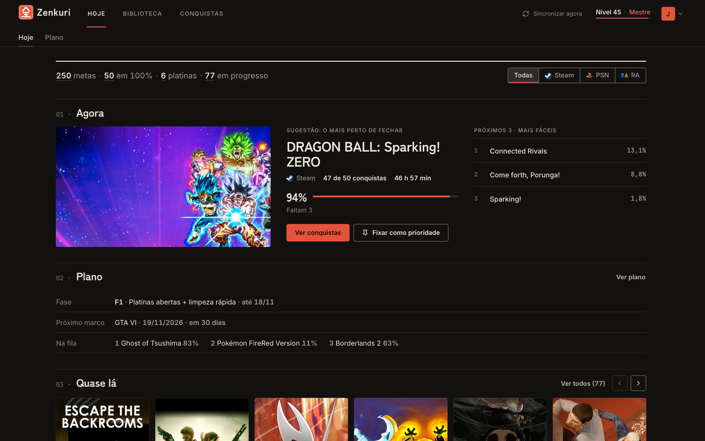
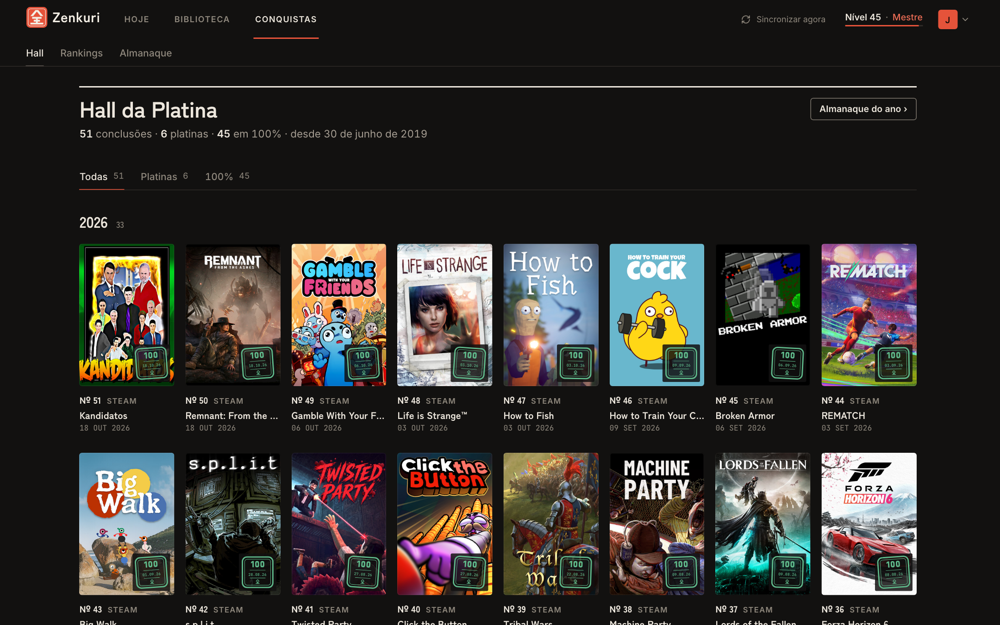
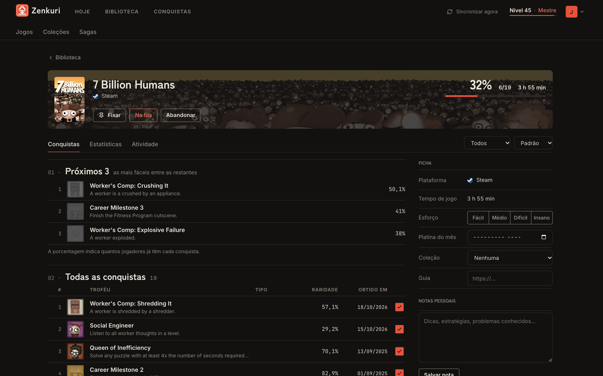
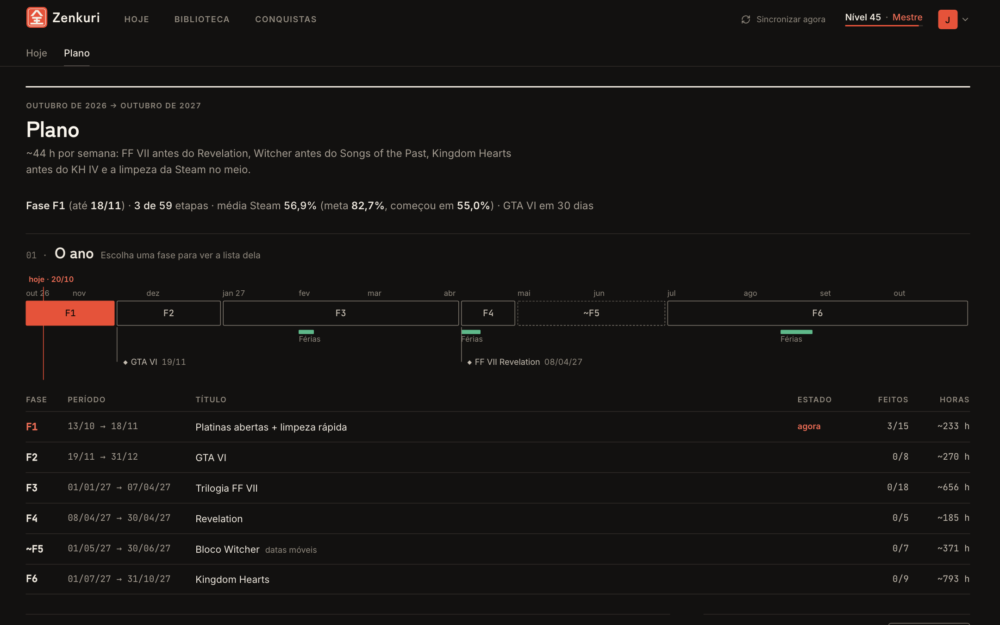
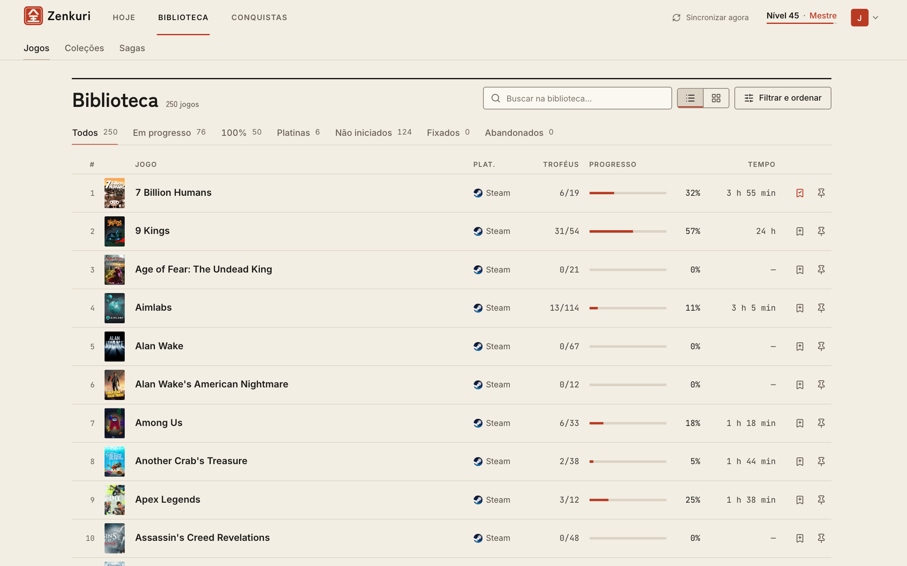
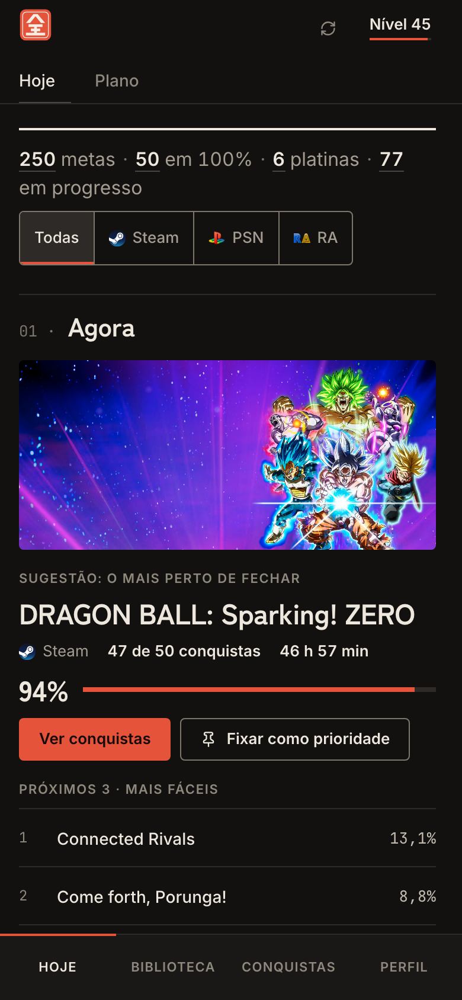
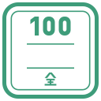

<p align="center">
  <picture>
    <source media="(prefers-color-scheme: dark)" srcset="public/brand/wordmark.svg">
    <source media="(prefers-color-scheme: light)" srcset="public/brand/wordmark-claro.svg">
    
  </picture>
</p>

<p align="center">
  <strong>Your strategy guide to 100% completion — Steam, PlayStation and RetroAchievements.</strong>
</p>

<p align="center">
  <sub>全クリ · zen-kuri</sub>
</p>

<p align="center">
  
  
  
  
  
  
</p>

<p align="center">
  
</p>

<table>
  <tr>
    <td width="50%"><br><sub>Platinum Hall</sub></td>
    <td width="50%"><br><sub>Game: checklist, notes and guide</sub></td>
  </tr>
  <tr>
    <td width="50%"><br><sub>Year plan</sub></td>
    <td width="50%"><br><sub>Papel (Paper) theme</sub></td>
  </tr>
  <tr>
    <td colspan="2" align="center"><br><sub>Today on mobile</sub></td>
  </tr>
</table>

## 01 · What it is

**Zenkuri** (全クリ) comes from 全クリア (zen-kuri-a), Japanese gamer slang for "100% cleared". It is a personal planner for platinums and 100% completions that brings **Steam**, **PlayStation Network** and **RetroAchievements** together in one place, so you can decide what to play next, track what you have already cleared and keep the context of each game (notes, guide, effort).

It is designed for private use, between work, studies and short play sessions: every screen exists to reduce the effort of choosing the next achievement. See [`PRODUCT.md`](PRODUCT.md).

### Identity

Hanko + strategy guide: a vermilion seal with 全, sumi-ink and paper neutrals, editorial layout, and completions recorded as dated stamps.

| Mark | Meaning |
| :---: | --- |
|  | The seal (hanko) with 全, "complete". The project's signature. |
|  | **Platinum** earned stamp. |
|  | **100%** completed stamp. |

### Languages

The app UI supports Portuguese (pt-BR) and English. All repository documentation is written in English. Community packs are authored in a single language, declared in the pack itself.

The UI labels quoted in this document use the English name first, followed by the current pt-BR label in parentheses on first mention, for example "Finish now (Fechar agora)".

## 02 · Features

| Page | What it does |
| --- | --- |
| **Today (Hoje)** | What to play now: pinned game, next 3 easiest trophies, plan phase, "almost there" and recent achievements. |
| **Plan (Plano)** | Year timeline organized in phases, manual, edited at `/plano`. |
| **Library (Biblioteca)** | List, grid and collection views (manual, **Franchises (Franquias)** and **Companies (Empresas)**); filters kept in the URL; infinite scroll. |
| **Sagas** | Saga guides published by the community (read-only). |
| **Community (Comunidade)** | Curated sagas and rankings, published as JSON packs in the repository (see [04](#04--community)). |
| **Game (Jogo)** | Trophy checklist, info sheet, personal notes, guide link and effort estimate. |
| **Achievements (Conquistas)** | **Platinum Hall (Hall da Platina)** (wall of stamps), **Rankings** (automatic and curated) and **Almanac (Almanaque)**. |
| **Tutorials (Tutoriais)** | In-app page (`/tutoriais`) explaining how to get the Steam Web API key and SteamID, the PSN NPSSO, and the RetroAchievements username and API key. |

It also includes:

- Levels based on achievements.
- **Zenkuri** (dark) and **Papel** ("Paper", light) themes.
- Local artwork cache with a source catalog (see [08](#08--artwork-and-local-cache)).

## 03 · Your data vs. community

Zenkuri separates what is only yours from what is shared.

| | Your data | Community |
| --- | --- | --- |
| **Where it lives** | Local SQLite database in `data/` | Versioned JSON packs in `community/` |
| **Who edits it** | You, in the app | Anyone, via pull request |
| **In the app** | Editable | Read-only |
| **Content** | Libraries (Steam, PSN, RetroAchievements) loaded by **Update**, manual collections, automatic collections by franchise or company, plan, game notes and automatic rankings | Curated sagas and rankings |

**Your data** never leaves your machine. `data/zenkuri.sqlite` (and `-wal`/`-shm`), `data/media/` and `data/personal/` are git-ignored; `data/imgs/` is versioned (platform icons).

- **Automatic collections** by franchise or company are derived from store metadata (developer, publisher, franchise). To fill in that metadata for games you have already updated: `npm run meta:backfill`.
- **Plan** is manual: you build and edit it at `/plano`. Nothing is AI-generated.
- **Game notes** are personal and live on each game's page.
- **Automatic rankings** (**Finish now (Fechar agora)**, **Quick wins (Rápidos)**, **Long hauls (Projetos longos)** and **Demanding (Exigentes)**) are computed from your own library, with deterministic rules and no LLM.

## 04 · Community

Curated sagas and rankings live in `community/<space>/` as versioned JSON files (`zenkuri.space/v1` and `zenkuri.publication/v1`). Today there is one space, `zenkuri`, with the Final Fantasy and Resident Evil sagas and the **Essentials (Essenciais)** ranking.

- When the server starts, the packs are imported into the local database, idempotently (by content hash). Deleting a file from the repository removes the publication from the database on the next startup.
- In the app, the content is read-only and shows up at `/comunidade`, with authorship shown as `@handle`.
- To publish: create or edit the file, run `npm run community:validate` and open a PR. Bump `version` on every change. Step-by-step instructions and a full example are in [`CONTRIBUTING.md`](CONTRIBUTING.md); the field reference is in [`community/README.md`](community/README.md).

In the future, a public database and bucket will replace the repository as the transport.

## 05 · Getting started

Requirements: Node.js and npm. `package.json` requires Node >=22.13 (`engines`); `.nvmrc` pins Node 24, which CI also uses (`nvm use` picks it up).

```bash
git clone https://github.com/joelkalil/zenkuri.git
cd zenkuri
npm install
cp .env.example .env   # fill in the credentials (section 06)
npm run dev
```

1. Open <http://localhost:5173> (web, Vite). The API (Express) starts at <http://localhost:4343>.
2. On the login screen, use **Create account (Criar conta)**. Each account has its own data.
3. Connect the platforms by entering public identifiers only (SteamID64 or profile URL, PSN Online ID, RetroAchievements username) and press **Update**.
4. Optional: `npm run meta:backfill` (franchise and company collections) and `npm run media:backfill` (pending artwork; requires the server to be running).

**Install scripts (better-sqlite3).** `package.json` has an `allowScripts` block approving `better-sqlite3`, `esbuild` and `fsevents`. `better-sqlite3` needs its install script to build (or download) the native SQLite binding. On npm versions that block dependency scripts, the block's approval should be enough. If the server fails with a missing binding error (`Could not locate the bindings file`), run:

```bash
npm rebuild better-sqlite3
node -e "const D=require('better-sqlite3');new D(':memory:').prepare('select 1').get();console.log('OK')"
```

CI does exactly this. You need a C/C++ toolchain (Xcode Command Line Tools on macOS, `build-essential` and Python on Linux) if no prebuilt binary exists for your Node version.

**Login.** The app has its own authentication. When migrating an old (single-user) database, the history is moved to a legacy user, defined by `ZENKURI_LEGACY_USER` and `ZENKURI_LEGACY_PASSWORD`. This does not apply to fresh installs. Change the password after the first login (details in `server/db.ts`).

## 06 · Configuration

Copy `.env.example` to `.env`. **Never commit `.env`** (it is already in `.gitignore`). The credentials belong to a server service account (Zenkuri reads only public profile data), never to app users. Whoever runs it locally uses their own keys.

| Variable | Required | Description |
| --- | :---: | --- |
| `ZENKURI_STEAM_API_KEY` | for Steam | Steam Web API key. |
| `ZENKURI_PSN_NPSSO` | for PSN | PSN `npsso` token (see below). |
| `ZENKURI_RA_USERNAME` | for RA | RetroAchievements username. |
| `ZENKURI_RA_API_KEY` | for RA | RetroAchievements API key. |
| `ZENKURI_API_PORT` | no | API port (default `4343`). |
| `ZENKURI_DB_PATH` | no | Alternative path for the SQLite database (default `data/zenkuri.sqlite`). |
| `ZENKURI_MEDIA_PATH` | no | Alternative folder for the artwork cache (default `data/media`). |
| `ZENKURI_COMMUNITY_DIR` | no | Alternative folder for community packs (default `community/`). |
| `ZENKURI_LEGACY_USER` / `ZENKURI_LEGACY_PASSWORD` | no | Legacy user used when migrating old databases. |

The optional variables are commented out in `.env.example`; uncomment only the ones you will change (an empty variable does not fall back to the default).

You only need to configure the platforms you will update; without the key, updating that platform fails with a message naming the missing variable.

**How to get each credential** (the in-app **Tutorials (Tutoriais)** page at `/tutoriais` covers the same steps)

- **Steam Web API key:** <https://steamcommunity.com/dev/apikey> (requires a Steam account; enter any domain). The profile to update must have game details set to public.
- **PSN `npsso`:** sign in at [playstation.com](https://www.playstation.com) with the account, then open <https://ca.account.sony.com/api/v1/ssocookie> and copy the `npsso` value. It expires periodically; when the PSN update fails, generate a new one and restart the server.
- **RetroAchievements:** the username is your profile's; the key (Web API Key) is at <https://retroachievements.org/settings>, under **Keys**.

Data is stored in `data/zenkuri.sqlite` (git-ignored).

## 07 · Scripts

| Command | What it does |
| --- | --- |
| `npm run dev` | API and web together. |
| `npm run dev:web` | Frontend only (Vite, `:5173`). |
| `npm run dev:api` | API only (`tsx watch`, `:4343`). |
| `npm run build` | Type check (`tsc -b`) and Vite build. |
| `npm run preview` | Serves the production build locally. |
| `npm run lint` | ESLint. |
| `npm test` | Runs every test script below, then `community:validate`. |
| `npm run test:level` | Level math tests. |
| `npm run test:collections` | Collection tests (manual and automatic). |
| `npm run test:community` | Community pack tests (validation and import). |
| `npm run test:rankings` | Automatic ranking tests. |
| `npm run test:server` | Server environment and error-code tests. |
| `npm run test:i18n` | Message key parity and localization tests. |
| `npm run community:validate` | Validates all packs in `community/`, without touching any database. Exits with code 1 on error. |
| `npm run meta:backfill` | Fills in store metadata (developer, publisher, franchise) for Steam and RetroAchievements games; the basis of automatic collections. Idempotent. |
| `npm run media:backfill` | Completes pending artwork in the cache (accepts `-- --dry-run`; the server must be running). |
| `npm run personal:import` | Imports plan and personal notes from a JSON file into an account (`-- --notes-only` imports just the notes, e.g. after updating games that were skipped) (see [`CONTRIBUTING.md`](CONTRIBUTING.md#legacy-personal-data)). |

## 08 · Artwork and local cache

Images are mirrored in `data/media/` (git-ignored), in folders by type: `covers`, `portraits`, `heroes`, `icons` and `achievements`. The `data/media/catalog.json` file records the source and provenance of each image.

- **Steam:** for newer apps, there is a fallback to the store assets.
- **PSN:** official artwork is fetched during an update (PS4/PS5 only).
- **Manual:** put an image with the same base name in the slot's folder. It takes effect and is never overwritten.
- **Backfill:** `npm run media:backfill` asks the running server for each pending image (placeholders and PSN slots that can be improved). Use `npm run media:backfill -- --dry-run` to only list them.

## 09 · Structure

```
zenkuri/
├── src/                 # frontend (React + Vite)
│   ├── pages/           # Today, Plan, Library, Game, Hall, Rankings, Almanac, Sagas, Login...
│   ├── components/      # TopNav, TabBar, Stamp, LibraryCard, plan/...
│   ├── context/         # authentication, theme, Steam data
│   ├── hooks/           # infinite scroll, media query, next easiest...
│   ├── lib/             # API client, cache, platforms, plan dates
│   ├── types/           # shared types (community, plan...)
│   └── styles/          # identity styles
├── server/              # Express 5 API + better-sqlite3
│   ├── providers/       # Steam, PSN and RetroAchievements
│   ├── community/       # validation (schema.ts), pack reading and import
│   ├── personal/        # personal file format and import (plan + notes)
│   ├── plan/            # manual plan
│   ├── rankings/        # automatic rankings
│   ├── collections/     # manual and automatic collections
│   ├── scripts/         # community:validate, personal:import, backfills
│   └── ...              # database, auth, levels, media and catalog
├── community/           # community packs (versioned JSON)
│   └── <space>/         # space.json, sagas/<slug>.json, rankings/<slug>.json
├── public/brand/        # wordmark, seal and stamps
├── docs/screenshots/    # screenshots used in this README
├── data/                # SQLite database, media cache and personal data (ignored); imgs/ is versioned
├── CONTRIBUTING.md
├── DESIGN.md
└── PRODUCT.md
```

**Stack:** React 19, Vite 8, TypeScript, Tailwind v4 and react-router 7 on the frontend; Express 5, better-sqlite3 and tsx on the API; integrations via `psn-api`, `@retroachievements/api` and the Steam Web API. Fonts: Zen Kaku Gothic New, Inter and JetBrains Mono.

## 10 · Contributing

Friends and collaborators are welcome: run it locally, open issues with feedback and send PRs. The [`CONTRIBUTING.md`](CONTRIBUTING.md) guide covers the development environment, branch and commit conventions, tests, how to publish a saga or ranking to the community, and the PR checklist.

## 11 · Design

- [`DESIGN.md`](DESIGN.md): visual system (colors, typography, components).
- [`PRODUCT.md`](PRODUCT.md): purpose, users, personality and principles.

---

<sub>Personal project, no usage license defined.</sub>
